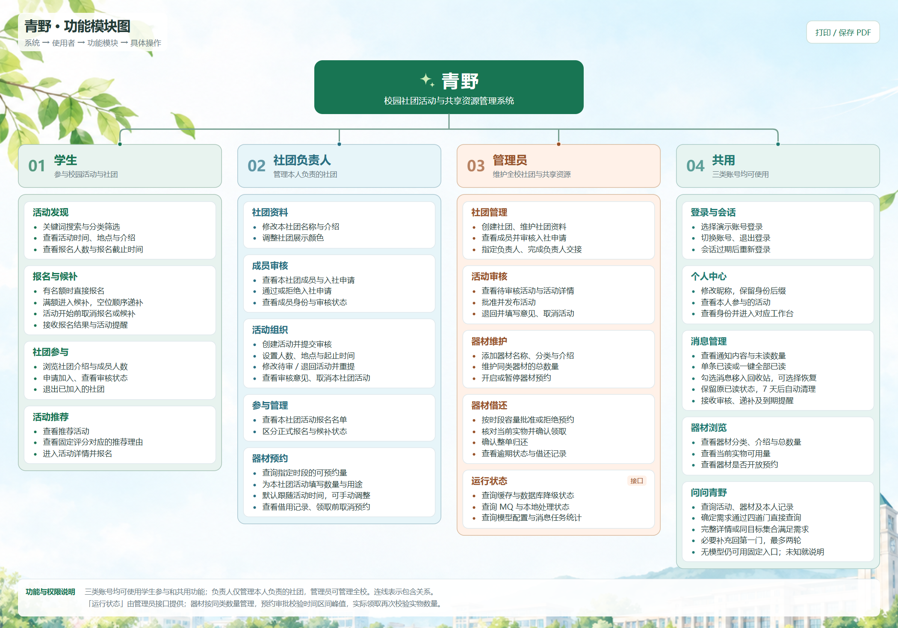
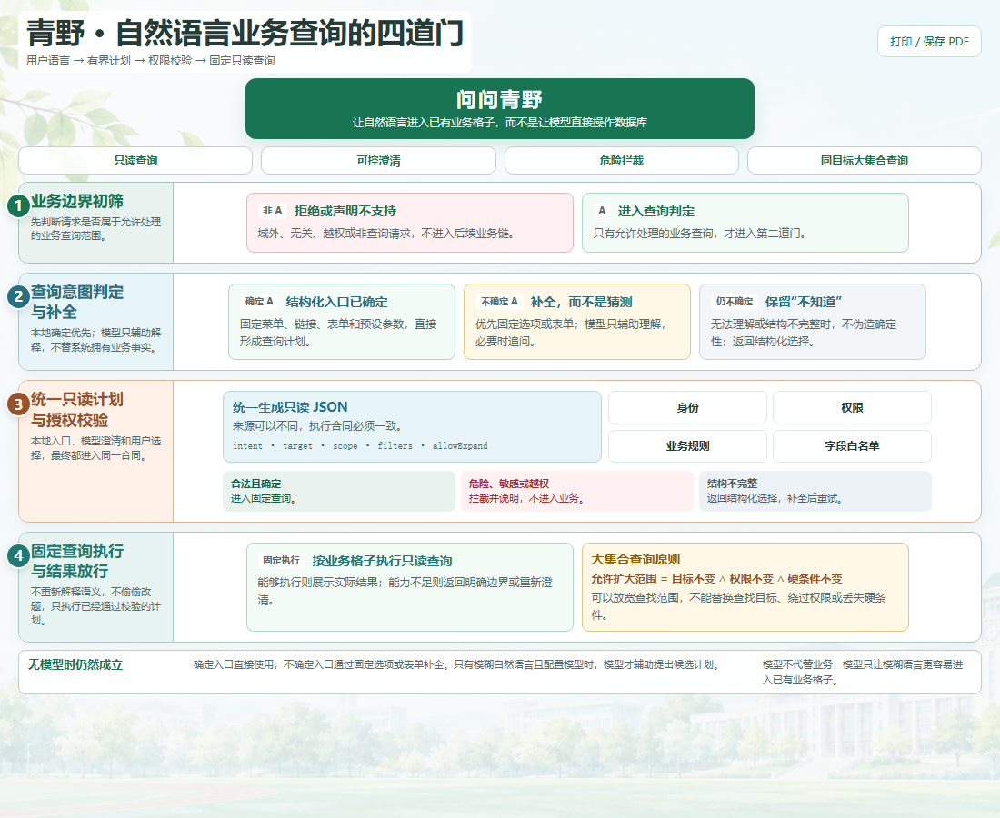

# 青野

**校园社团活动与共享资源管理系统的设计与实现**

许可证：[Apache-2.0](LICENSE)。版权与第三方声明见 [NOTICE](NOTICE)；第三方依赖与素材保留各自许可。

Java 17 / Spring Boot 单体、MySQL 8、原生微信小程序。主线是「社团 → 活动 → 报名 / 候补 → 器材预约 → 审批 → 领取 → 归还」，三类用户共用小程序，管理操作在工作台完成。Redis、RabbitMQ 和模型能力可降级。

## 功能模块图

[](docs/功能模块图.html)

四列分别展示学生、社团负责人、管理员与共用功能。需要修改或打印时，下载 [HTML 模块图](docs/功能模块图.html) 离线打开；校园背景已内嵌，无需联网。

## 校园助手：四道门只读查询

[](docs/助手四道门.html)

图示已对齐两轮回流与直接查询。实现路径、新测试结果和已知边界见[两轮四道门](docs/assistant-four-gate-loop-20261030.md)；此前迁入坐标保留在[分支补迁记录](docs/four-gate-integration.md)。

四道门把业务能力与模型解释分开：第一门限定业务边界；第二门让固定入口、表单和结构化选择直接形成确定请求，只在自然语言含糊时使用模型辅助；第三门把本地、模型和用户选择统一收敛到有限只读协议、会话身份及字段白名单；第四门只调用对应业务格子的固定查询。模型不可用时，活动目录、器材库存、本人报名和本人借用仍可直接使用。

新增社团、活动或器材只增加业务数据，不修改格子或提示词。2026-10-30 后端完成两轮四道门改造，三家模型各重新运行 391 个任务：最终 657 次查对，469 次停止、未找到或信息不足，1 次查错，46 次技术故障；未观察到写入或越权读取。第二轮补充使 62 个任务完成查询，均计入原任务。前端与外部对账未参与，详情及逐题证据见[本轮报告](docs/assistant-four-gate-loop-20261030.md)。此前 372 次调用等历史成绩不计入本轮。

同日豆包 2.1 Pro 非思考模式独立完成全部 391 题：最终 222 题查对、168 题停止或未找到、1 题协议故障、0 题最终查错。37 题追加交互使查对数从 191 增至 222；首轮的两条错误仍保留。168 题停止中，151 题有合理依据、4 题本可处理、13 题受多项入口限制。报告、原始回包与离线复核入口见[豆包完整题库证据](docs/assistant-doubao-full-20261030.md)。

仍未解决的是通用自然语言语义一致性：合法 JSON、合法权限和真实来源片段仍不能证明字段与用户原意绑定正确。例如“今天借用”可能被绑定到计划使用日期。这一一般性问题在本项目中明确记为未解决边界，不继续增加模型权限、中文关键词补丁或新的语义证明机制，也不宣称已经解决。

## 运行

1. 在 MySQL 客户端或 Navicat 完整执行 [sql/qingye.sql](sql/qingye.sql)。单个文件包含建库、九张表和五个演示身份及业务数据。重复导入会替换 `qingye` 中的同名表；已有正常数据时无需再次导入。快照保留当时的活动日期，日期过期后可在工作台取消旧活动并创建新的演示活动。

2. 准备 Java 17、Maven、MySQL 8、微信开发者工具。在青野目录运行：

   ```powershell
   $env:QINGYE_DB_USER = '<数据库账号>'
   $env:QINGYE_DB_PASSWORD = '<数据库密码>'
   cd backend
   mvn "-DskipTests" package
   cd ..
   .\scripts\start.ps1 -SkipBuild
   # 可选：启用本机已运行的中间件
   # .\scripts\start.ps1 -SkipBuild -Redis -Mq
   ```

   首次构建用普通 Maven 下载所需依赖；缓存齐全后可离线构建。默认后端为 `http://127.0.0.1:8087`。也可在 IDEA 导入 `backend/pom.xml`，为运行配置设置上述数据库环境变量及 `QINGYE_DEMO=true`，运行 `cn.qingye.QingyeApplication`。再次构建前先停止正在运行的青野，避免 Windows 锁定 JAR。

3. 微信开发者工具导入 **`miniprogram/`**，导入时选择自己的开发或测试 AppID；仓库配置中的 `touristappid` 是占位值。开发阶段关闭合法域名校验，编译后选择演示身份。前端通过 `wx.request` 直接连接后端，不需要 Node 业务服务或网页前端监听端口。

`start.ps1` 先加载本机 `local.ps1`，保留其中或环境变量已设置的 `QINGYE_DEMO`；只有未设置时才默认启用演示模式。`-RealWechat` 始终关闭演示登录；也可显式设置 `QINGYE_DEMO=false`。关闭演示模式后仍需配置正式登录所需参数，不代表已取得真实微信登录或部署资格。

### 真实微信登录与账号权限

小程序用 `wx.login` 获取一次性 code，只把 code 发给后端。后端向微信兑换身份，再签发青野自己的八小时会话。AppSecret、openid 和微信 session_key 不返回前端。失败重试会重新获取 code，同一微信身份重复或并发登录只对应一个账号。

服务端配置 `QINGYE_WX_APPID`、`QINGYE_WX_SECRET`、至少 32 字符的独立随机 `QINGYE_TOKEN_SECRET`，以 `-RealWechat` 启动。签名密钥应由部署配置稳定保存，不能与微信密钥共用。正式环境使用持久化 MySQL、HTTPS 和小程序已配置的 request 合法域名；仓库里的 HTTP 局域网地址只用于开发预览。真实模式不开放演示登录，也不把遗留的演示管理员算作可用的正式管理员。

新账号一律获得普通用户权限；微信登录不验证学籍，也不根据昵称授予管理员或社团负责人身份。“我的”显示账号 ID，便于当面核对身份。已有管理员从“工作台 → 账号管理”按昵称或账号 ID 查找用户，明确确认后授予或撤销管理员权限。社团负责人仍由社团成员关系确定，撤销管理员不删除社团身份。

首位管理员由部署维护者核实真实微信账号 ID 后，在维护窗口从数据库显式初始化：先确认尚无启用的非 `demo:` 管理员，再核对目标账号的 ID、昵称和启用状态，更新该账号的 `admin` 字段，并保留运维记录。服务不会把首位注册者自动设为管理员，也没有公开的首次提权接口。后续变更通过账号管理完成。

管理员变更在一个数据库事务中按固定顺序锁定管理员记录，等待后重新校验操作者权限；至少保留一位启用且可登录的管理员。角色更新与 `account_role_audit` 审计记录一起提交，记录操作者、目标、前后权限和时间。相同变更重复提交不重复记账。已有库启动时仅新增这张审计表，不重建或清空业务表。每次请求重新读取账号权限，所以撤权后已有会话不能继续使用管理员能力。

并发登录、两位管理员同时撤销自己、等待期间被撤权等情况由数据库与 HTTP 测试覆盖。它们验证权限正确性，系统容量需在实际部署环境另行压测；数据库连接数不能换算成最高在线人数。

真机预览时，手机与电脑接入同一受信任局域网，将 `miniprogram/utils/config.js` 的地址改成电脑当前局域网 IP，并设置 `QINGYE_BIND=0.0.0.0` 后重启后端。演示身份选择不是正式认证；监听全部网卡不会自动关闭演示模式，不应将演示登录暴露到不受信任的网络。端口可由 `QINGYE_PORT` 指定。数据库密码、模型密钥等仅放环境变量或被忽略的 `local.ps1`；私人 AppID 配置、构建产物与日志不提交。

首次使用空库时，演示模式可初始化5个身份、7个社团、9场活动、8类器材（本轮各新增4条社团/活动/器材及5张配图）；包含往期、进行中、明天、后天的活动。已有库不自动灌数据、不重置业务记录；若确为演示库，可显式执行[增补脚本](sql/demo-additions-20261021.sql)，重复执行不重复插入。请勿为增加示例而重新导入完整旧快照。这个项目使用本机软件，不要求 Docker 或 uni-app。

发现页保留搜索入口、校园轮播、快捷入口与“可能正合你意”。“查看全部”和搜索进入独立的校园活动页，活动分类、搜索结果及分页在该页展示；最近搜索按账号在本机保留最多五条，可点击复用、逐条删除或清空。删除记录不发起查询、不改变当前结果。返回活动列表时保留关键词、分类和已加载范围。

问问青野按提问、必要补充和结果分别展示；新四门接口返回结果后直接显示，查询条件折叠查看，不另加确认弹窗。“重新提问”保留原句供编辑，“自己查找”进入独立目录页：先选择校园活动、器材库存、我的报名、我的借用中的一至四类，再分别查看结果和筛选。各类条件与结果独立保留；不需要保存或组装查询。返回选择页保留当前条件，页面左上角返回问青野时保留原结果。补充和纠正仍由服务端限制为最多两轮，前端不重新解释查询；旧版确认响应仅保留兼容处理。

发现页与“我的”共用校园大图轮播：停留时完整铺满，五秒后左右切换，缩放随滑动同步完成；推荐活动每两张一组，在固定卡片容器内切换。轮播默认自动播放，触摸后停止，同次浏览返回页面也保持停止；界面只保留位置圆点。底部导航常驻“问青野”：管理员与社团负责人在工作台进入器材室；普通同学的底部导航显示器材室。工作台进入时继续核验当前身份。活动报名名单与工作台成员名单随整页滚动，收起按钮在名单末尾，重新展开读取最新名单。

“问问青野”按提问、必要补充、查看结果展示当前操作。一次查询的结果放在同一大卡片中，每条记录有独立的小卡片；查找条件可展开，业务提醒直接可见。“没找对”在结果开头，补充时保留原问题；取消补充或重新提问可回到原结果。顶部“返回”回到问青野起始页，可重新提问或进入独立的“自己选条件查找”页面。未查出记录时不展示“找到了／没找对”反馈按钮。上述变化仅在前端，不调整四道门、模型提示词或查询合同。

## 项目说明

- [项目简介](docs/项目简介.md)：功能、九张表、后端分层、核心算法、降级与验收范围。
- [功能模块图](docs/功能模块图.html)：按学生、社团负责人、管理员、共用四列并列，分别向下展开；下载后双击离线查看或打印。
- [运行素材说明](miniprogram/assets/README.md)：小程序实际使用的校园、器材图片及图标许可。

器材按同类数量预约。时间区间峰值扫描计算容量，MySQL 行锁保护最终审批；领取时再次核对全部未归还数量。负责人权限来自具体社团成员关系。消息可全部已读，也可选择后移入回收站；7 天内可选择恢复并保留已读状态，到期自动清理。

受资源锁保护的管理写操作，在等待后重新核对数据库中的账号启用状态、管理员身份或当前社团负责人关系。
活动取消若随后又等待器材锁，结束前再核对一次；撤权则回滚本次业务改动和通知。请求中的身份快照仍用于读取，
该边界不承诺权限在最后一次核对之后发生变化时也能撤销已经执行的操作，也不新增账号行锁。

登录页在身份列表加载或登录失败时显示故障卡片，区分 403、404、429、5xx、断网、超时和无效响应；可重试或返回选择身份。只有有效的登录响应才能建立会话，已登录接口的 401 仍退出过期会话。

校园助手的业务目录、表单与固定入口独立于模型；用户可直接查询公开活动、器材库存、自己的报名及借用。模型是可选语义入口，只辅助定位这些业务集合与明确条件，不生成 SQL、身份、事实答案或新的能力。
四道门依次承担初筛、确定性/模型澄清、有限只读协议与授权、业务格子到固定查询的确定性闭合。陌生社团或活动名不等于域外，新增业务数据不需要更新提示词或规则。固定入口仅匹配完整公开命令，不维护不断增长的中文句式词典。
可以返回同一目标的完整授权详情或相关候选；摄影不等于艺术大类，不擅自添加 CURRENT，不丢用户明确条件。没有指定日期不妨碍按名称查活动；无法表达的硬条件明确说明，不用宽结果冒充完成。
只有缺少必要信息才追问，保留原请求、已有问题和回答；模型只选择合同内的追问类型，中文问题由本地生成。原前端的助手页、“自己查找”独立页和确认交互本轮未重写，不作为当前后端流程的界面验收证据。
当前后端采用两轮四道门：确定请求直接执行已校验的只读计划；必要补充或结果纠正保留原目标，从第一门重新进入。第二轮仍未确定则返回 UNKNOWN，技术重试和分页不增加业务轮次。模型故障时原业务查询继续可用，不让本地重新解释原句兜底。私人查询身份只取认证会话，管理员也不扩大助手权限；只读不等于可读取他人的私有数据。
模型回包结构或枚举违规时使用 `INVALID_PROTOCOL`，与 `MODEL_UNAVAILABLE` 分开；重复 JSON 键、重复筛选字段等继续严格拒绝。保留原请求与补充供用户主动重试，不自动重发，不用修补后查询掩盖原失败。名称来源、条件来源或条件编译不成立时，保留 `qualificationFailure`，进入现有有界澄清或未知；不执行未通过的候选。此机制不能识别所有结构合法的语义遗漏。
模型输出字典、完整示例与解析要求由 `assistant-locator-protocol.json` 同源提供；该字典不增加业务能力。安全边界、业务满足与协议交接分别验收，不将正确停止当作已完成查询，也不以展示候选替代原任务。
最多四项独立结构化查询分别校验后执行，不支持任意关联、排除、统计或依赖执行。结果每页十条，可按相同条件继续；分页不是快照。名称和登记别名未匹配时如实返回未找到，不承诺自动纠错或翻译。详情卡来自授权数据库字段；缺少负责人姓名或器材存放地点时不编造。
模型可能选错格子或遗漏条件，合法 JSON、真实事实和用户确认都不单独证明语义正确。当前执行流程及验收范围见[两轮四道门](docs/assistant-four-gate-loop-20261030.md)。[业务优先四道门 v5](docs/assistant-business-first-v5.md)记录此前能力合同。[v4.2/v4.3](docs/assistant-completion-v42.md)、[v4.1](docs/assistant-contract-v4.md)、[此前真实模型复查](docs/assistant-validation-v4-20261021.md)和 [v3](docs/assistant-contract.md)保留为历史证据，不代表 v5 已通过同一轮实验。
模型密钥仅通过本机环境变量提供，不随源码交付。可在环境变量设置 `QINGYE_LLM_URL`（完整 chat-completions 地址）、`QINGYE_LLM_KEY`、`QINGYE_LLM_MODEL`。

模型接入交接修补见[能力表、请求参数与复测记录](docs/assistant-model-handoff-20261029.md)。模型可见时间选项从每个业务格子的有效配置展开，包含继承值。`gpt-6-astra` 使用 `max_completion_tokens=2048`、`reasoning_effort=low`、默认温度及 `store=false`；DeepSeek、千问保留原请求参数，共用业务提示词。模型请求及完整响应体默认期限为 18 秒，可通过 `QINGYE_LLM_TIMEOUT_MS` 配置为 100—18000 毫秒；无效配置停止模型调用。小程序的提问、自然语言澄清和主动重试等待 20 秒；固定查询保持 10 秒。超时不自动重发，业务目录仍可直接使用。`transportFailure` 区分超时、连接、DNS、TLS、HTTP 状态、响应超限等原因，不透传内部异常或凭据。修复与复验见[接口权责修补](docs/assistant-contract-handoff-20261030.md)。

## 工程维护与复验

截至 2026-10-30，模型交接修补（PR #13）、查询后反馈与 Python 经验模块（PR #14）、反馈 HTTP 拒绝修复（PR #15）及 Tomcat 升级（PR #16）均已合入独立仓库。
主线 `3b261d2` 的 [CI](https://github.com/NoctilumeDev/Qingye/actions/runs/40860881604) 三项必需检查通过：客户端 82 项、维护脚本普通/优化模式各 60 项、Python 反馈 9 项；H2 185 项全部执行，MySQL 执行 180 项，其余 5 项 RabbitMQ 用例由 H2 job 的真实 RabbitMQ 环境验证。
本轮工程改动已交付；真实模型采集中的错误预览、协议拒绝和停止分类偏差仍按[原结果账](docs/assistant-model-handoff-20261029.md)保留。存在业务回归的 [PR #10](https://github.com/NoctilumeDev/Qingye/pull/10) 仍为草稿，未合入。

查询完成后的补充通过结果凭据继续同一任务，并重新经过第一门。当前查询链已解除 [Python 反馈经验模块](tools/feedback-learning/README.md) 的调用；其旧实现单独保留，不参与本轮查询、纠正或成绩。外部业务对账将在本轮测试后另行设计。当前后端改造与新测试口径见 [两轮四道门](docs/assistant-four-gate-loop-20261030.md)，此前实验不作为这版验收结果。

RabbitMQ 客户端的有界升级、旧新版对照及公告迁移边界见[第二轮维护记录](docs/governance/rabbitmq-maintenance-20261023.md)；历史不适用和未知记录不包装成升级成果。

Tomcat 10.1.61 的 HTTP/2 authority 边界修复、旧新版实测及构建产物核对见[维护记录](docs/governance/tomcat-maintenance-20261029.md)。

青野现由本仓库独立维护。源码从 `dome/qingye` 的精确坐标提炼，来源、历史关系与权威切换见 [ORIGIN.md](ORIGIN.md)。[独立 CI](.github/workflows/ci.yml)在当前仓库运行，不以浏览器演示构建代替后端验收。

[仓库治理与资格边界](docs/repository-governance.md)记录主线保护、检查职责与首败。本轮只对齐工程护栏，不打包发布，不改变已确认的展示页面或业务范围。
维护入口见 [贡献说明](CONTRIBUTING.md)，已知候选与未知条件见 [风险账册](docs/governance/risk-register.md)。架构约束、覆盖率、静态及完整依赖变更检查、敏感信息特征各有[明确范围](docs/governance/continuous-checks.md)，不代表模型语义正确或全部风险已关闭。

Java17、Maven3.9、Python3.10+、Node24.14.0。从本目录运行：

```powershell
python -B scripts/check.py quick  # 门禁 + 客户端 + H2 + 静态分析，不连接MySQL
python -B scripts/check.py dependencies  # 联网重新解析并扫描完整项目依赖，CI 另行执行
# 显式准备独立 qingye_test 与仅有该库权限的测试账号后：
$env:QINGYE_TEST_URL = 'jdbc:mysql://127.0.0.1:3306/qingye_test?characterEncoding=utf8&serverTimezone=Asia/Shanghai'
$env:QINGYE_TEST_USER = '<测试账号>'
$env:QINGYE_TEST_PASSWORD = '<测试密码>'
python -B scripts/check.py all    # 再执行真实MySQL测试
```

单项为`hygiene`、`client`、`h2`、`mysql`、`static`、`dependencies`。`dependencies`不包含在本地`quick/all`中，网络失败不记为通过。缺工具/测试凭据或非qingye_test URL直接拒绝；MySQL测试会清空测试业务表，必须专库专用。H2命令只在子进程移除MySQL测试环境，保留调用者配置。`client`检查JSON/JS/WXML结构和实际页面脚本测试；微信原生编译另运行`python -B scripts/check-client.py --compiler-dir <现有wcc-exec目录>`，结构检查不冒充编译或真机证明。旧`test-mysql.ps1`只作为本机便利入口，CI与维护统一使用上述显式变量。

数据库DATETIME按上海本地业务时间保存，读取使用LocalDateTime，避免经JVM默认时区转换。新增CI首次在UTC宿主击穿了原日期映射，原[失败运行](https://github.com/NoctilumeDev/dome/actions/runs/37214544021)保留；修正按同样UTC条件复验。

### 遗留物收口门禁

阶段退出：实现 → 测试 → 文档/公开读回 → 遗留物收口 → 结束。`hygiene`只读检查本仓库Git跟踪的已知构建/运行态/私有配置及当前文档本地链接，另有负控制；不自动删除图片或数据库，不单独证明LOCAL_DORMANT。

负责人还须逐项核对owner、当前consumer和proof obligation：页面/README/展示/Release依赖素材及正式证据绑定资产保留；纯历史废案在确认无当前职责后删除；首败、关键反例、最终见证和回执保留。不能因为没搜到引用就断言图片无用，也不能因为历史说明引用就永远保留废案。构建实例可重建才清；原Release/evidence包不拿新包冒充。唯一数据未知则REVIEW_REQUIRED。

本地收尾先确认源码、锁文件、SQL、配置模板与脚本已在远端，再停止自己创建的进程并清理本轮依赖/编译/临时实例；共享MySQL、中间件、其他项目及未提交用户改动保留。门禁通常只留阶段结果和必要例外，详细删除看Git diff；不创建永久删除清单，不按仓库体积考核。

截至 2026-10-02，H2 / MySQL 各 43 项、前端 39 项、十页原生编译通过；已检查并发、权限、真实中间件传输与降级。本轮 6 类真实 DeepSeek 查询、16 个本地拒绝样例及认证、参数边界通过，测试前后九张业务表内容一致；供应商正文卡住可在截止时间内降级。回收站清理、恢复、未读状态、账号隔离、空状态及定时清理已在实际编译页面验收。用户在安卓真机确认助手、预约、昵称三组键盘避让正常；其他机型未逐一验证。真实微信登录、正式 HTTPS / 微信审核、学校部署和高负载容量不属于当前验收范围。

维护以业务边界、源码可读性和可复验行为为准，不以行数作为正确性或清理指标。文档保留项目简介、模块图及主页预览截图，过程材料可在 Git 历史中查看。

2026-10-08 权限维护复验：当前 H2 / 专用 MySQL 各 52 项、客户端 39 项、维护脚本 4 项通过。
请求链由 MockMvc 托管；MySQL 用实际行锁等待见证撤权顺序，覆盖管理员身份撤销、账号禁用、
管理员管理捷径、负责人撤销对照、权限保留对照，以及活动取消在后续器材锁等待后的完整回滚。
本次没有重复执行微信原生编译或真机验收，也不把托管请求链标作常驻 HTTP 服务验收。

2026-10-08 助手查询类型维护（旧合同，现由能力合同 v2 替代）：模型返回 `OUT_OF_SCOPE` 不再覆盖本地四种查询类型；
创作请求仍在本地拒绝。H2 / 专用 MySQL 各 53 项、客户端 39 项、维护脚本 4 项通过。
真实 DeepSeek Flash 用测试托管服务与 H2 事实重放 30 个代表性问题，14 次外部请求成功，
12 个计划接受、2 个越界计划降级，16 个请求在本地拒绝；九张业务表内容前后一致。
同问题的豆包 Responses 测试因本机解析/网络不可达触发截止降级，当次未取得实际模型回答；
测试协议适配层未并入产品。后续 2026-10-30 的 [Chat Completions 完整题库实测](docs/assistant-doubao-full-20261030.md)另行保留，不改变这次历史结果。

2026-10-08 语义污染对照：在同一 `53c31589` 源码、冻结 Clock、数据库快照和 133 题顺序上，
DeepSeek Flash / Qwen Plus 各完成 79 次原生产品调用、17 次仅 planner 诊断，全部取得 HTTP 响应。
权限/展示字段/只读断言通过，九表内容未变；但两边各有 16 个最终类型错误（12 个查错分支、4 个误拒），
另有类型正确却查错实体的情况。本地兜底不保证语义正确，历史动作、否定、改口和多意图仍有已知缺口。
详见[旧候选对照结果与失败入口](docs/semantic-comparison-20261008.md)。这些结果绑定旧 `53c31589`；
随后按[当前能力合同](docs/assistant-contract.md)修复，取消手写请求切分器。新候选两家各跑133＋2题，
范围确认前没有业务记录读取，九表未变；仍有模型理解错误，不报告133/133全对。
[修复结果与逐题入口](docs/semantic-repair-20261008.md)将语义质量和执行资格分开；本机H2 69项、客户端43项、原生编译通过。
