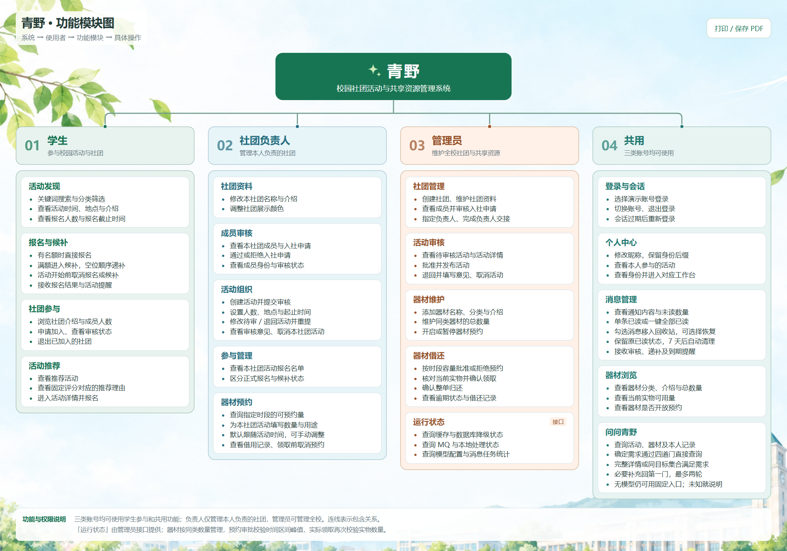
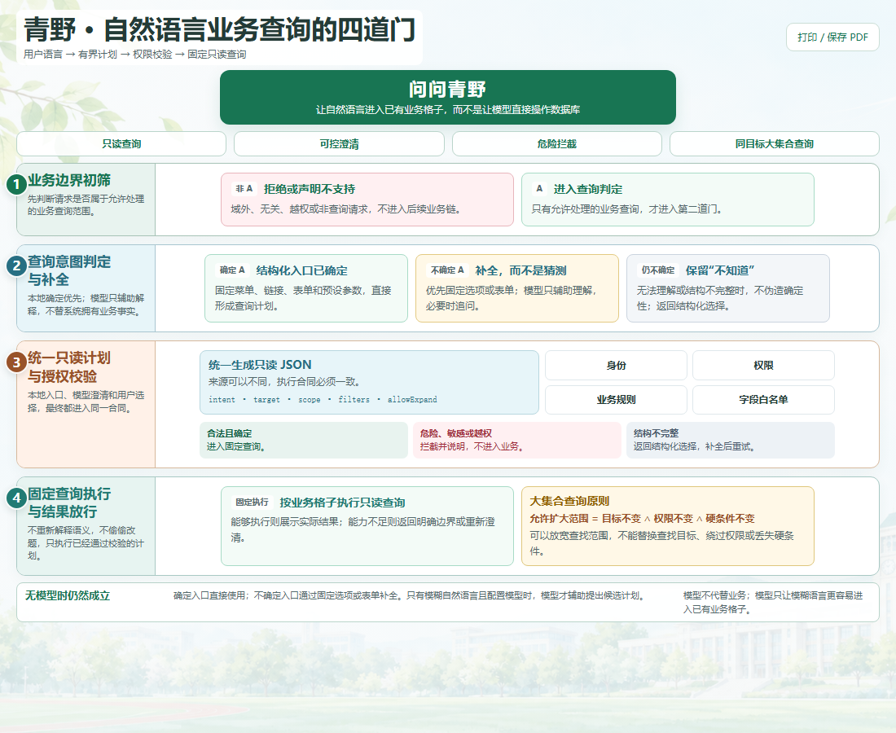

# 青野

**校园社团活动与共享资源管理系统**

找社团、参加活动、预约器材、接收校园消息，都在一个微信小程序里。同学参与校园生活，社团负责人组织活动，管理员处理审核和共享资源。

Java 17 · Spring Boot · MySQL 8 · 原生微信小程序。一个后端提供业务，语言模型是可选的查询入口。

**[下载 v0.1.0](https://github.com/NoctilumeDev/Qingye/releases/tag/v0.1.0)** · [部署说明](docs/deployment.md) · [项目简介](docs/项目简介.md) · [测试与压测报告](docs/release-check-20261104.md)

许可证：[Apache-2.0](LICENSE)。版权和第三方声明见 [NOTICE](NOTICE)。

## 能做什么

| 使用者 | 主要功能 |
| --- | --- |
| 同学 | 浏览社团介绍、申请入社；报名活动、候补和取消；查看器材及自己的借用记录；阅读消息与公告 |
| 社团负责人 | 维护社团介绍、审批成员、发布活动、查看报名名单、为活动申请器材 |
| 管理员 | 审核活动、维护器材、审批借用、登记领取和归还、管理账号权限、发布校园公告 |

发现页提供活动搜索、校园轮播和推荐活动。最近搜索按账号在本机保留五条，可复用、逐条删除或清空。管理员和负责人从工作台进入器材室，普通同学从底部导航进入。

消息支持已读和回收站，删除后七天内可恢复。公告支持个人归档与恢复；管理员维护自行发布的公告，两条预置使用指引随项目维护。并发编辑发生冲突时保留草稿，避免覆盖他人的修改。

[](docs/功能模块图.html)

[打开或打印功能模块图](docs/功能模块图.html)，下载 HTML 后可离线查看。

## 问问青野：能查就查，需要补充时再问

“明天有哪些活动？”“相机还有多少？”“我报了哪些活动？”——用一句话开始，结果按记录展示为卡片。也可以进入独立的“自己查找”页面，选择活动、器材、本人报名或本人借用，各类条件分别筛选。

已有业务能力是查询的基础。四道门负责把用户请求接到这些能力上：

| 门 | 做什么 |
| --- | --- |
| 第一门：业务初筛 | 拦住能够明确判定的越界请求；尚不能判断的自然语言保留，陌生名称不等于域外 |
| 第二门：意图判定与补全 | 对照业务格子判断确定、不确定和其他；固定入口直接形成请求，模型辅助解释自然语言，必要时补充 |
| 第三门：只读协议与授权 | 校验有限字段、取值、来源和查询资格；主体取自登录会话，模型不能指定 SQL、他人身份或执行接口 |
| 第四门：固定查询与结果 | 调用对应业务能力的固定查询，返回授权记录、同目标候选，或明确说明未知、无匹配及停止原因 |

**不要求精准定位到最小结果。** 问活动地点，可以返回包含地点的完整活动卡；只确定要看器材，也可以查看授权器材目录。集合查询保持目标、已记录条件和权限，不能把摄影活动换成全部艺术活动，也不能为扩大结果删除已确定的日期条件。

**正常请求一轮完成。** 必要补充或结果纠正携带原问题和上下文，从第一门重新处理；同一任务最多两轮，仍不能确定就明确说明不知道。后端直接执行合格的只读计划，不要求用户逐次核对内部参数。

**业务查询不依赖模型。** 模型关闭时，目录、表单和固定查询继续工作。新增社团、活动或器材只增加数据，不增加格子或关键词规则。助手只读公开信息和当前用户自己的记录，管理员身份也不会扩大助手的私人查询范围。

[](docs/助手四道门.html)

[查看架构图](docs/助手四道门.html) · [业务能力配置](backend/src/main/resources/assistant-contract.json) · [模型候选协议](backend/src/main/resources/assistant-locator-protocol.json) · [执行流程与题库](docs/assistant-four-gate-loop-20261030.md)

## 实测结果

完整题库有 391 个任务，覆盖正常业务、长尾表达、攻击输入、历史反例和交互纠正。每个原始任务按最终业务结果计一次：合法集合覆盖、纠正后查对都算查对；停止与技术故障单独记录。

| 实验 | 查对 | 停止、未找到或信息不足 | 查错 | 技术故障 |
| --- | ---: | ---: | ---: | ---: |
| DeepSeek、千问、GPT：1173 条冻结回包，经接口修复复算 | 666 | 493 | 1 | 13 |
| 豆包 2.1 Pro：391 个任务独立实测 | 222 | 168 | 0 | 1 |

第一行使用同一批模型回包比较程序修复前后；另有 174 个定向任务重新调用三家模型，结果独立保留。豆包的 37 题追加交互将查对数从 191 提高到 222；168 次停止中，151 次有合理依据、4 次本可处理、13 次受多项入口限制。停止并不都代表理想处理，具体原因和首轮错误见[接口修复对照](docs/assistant-contract-handoff-20261030.md)与[豆包完整题库证据](docs/assistant-doubao-full-20261030.md)。

在上述测试范围内未观察到写入或越权读取。模型仍可能遗漏用户条件，合法 JSON 和真实来源片段不能自动证明语义理解正确；这些反例保留在逐题记录中。

### v0.1.0 工程验证

发布源码为 `7001a232f9b21602b9288bfd889fb0deb77bb424`，合并后[主线 CI](https://github.com/NoctilumeDev/Qingye/actions/runs/41820722931)的客户端与维护、H2、MySQL 三项必需检查全部通过。

| 检查 | 结果 |
| --- | --- |
| 本地 H2、专属 MySQL | 各 215 项：210 项通过，5 项 RabbitMQ 用例由远端 H2 作业的真实 RabbitMQ 环境运行 |
| 客户端 | 127 项通过 |
| 维护与打包脚本 | 94 项，普通与 Python 优化模式通过 |
| 微信原生编译 | 17 页通过 |
| 实际页面交互 | 公告发布、编辑、阅读、归档、恢复、删除，以及关闭模型后的固定器材查询 |

单机 HTTP 压测使用 8 个数据库连接、512 MiB Java 堆，均衡调用 11 条只读路径；每档预热 5 秒、测量 30 秒：

| 并发请求 | 每秒请求 | p95 | 错误或超时 |
| ---: | ---: | ---: | ---: |
| 1 | 286.3 | 15.6 ms | 0 |
| 8 | 1,617.4 | 22.3 ms | 0 |
| 32 | 1,649.2 | 39.2 ms | 0 |
| 64 | 1,654.7 | 64.5 ms | 0 |

累计 156,399 次请求。后端、MySQL 和压力客户端位于同一台 Windows 电脑（i7-14650HX、约 16 GiB 内存），模型、Redis 和 RabbitMQ 关闭。这是该环境下的只读吞吐，不能换算为最高在线人数或模型响应速度。原始数据、配置和测量方法见[压测报告](docs/load-test-20261104.md)；完整验证范围见[发布检查](docs/release-check-20261104.md)。

## 运行青野

### 使用发布包

下载 [Qingye-v0.1.0.zip](https://github.com/NoctilumeDev/Qingye/releases/download/v0.1.0/Qingye-v0.1.0.zip) 和[校验文件](https://github.com/NoctilumeDev/Qingye/releases/download/v0.1.0/Qingye-v0.1.0.zip.sha256)。包内包含后端 JAR、小程序源码、建表脚本、配置模板，以及对应版本的项目和第三方源码、许可材料。

准备 Java 17、MySQL 8 和微信开发者工具，按[部署说明](docs/deployment.md)配置数据库、微信 AppID/AppSecret、独立签名密钥和 HTTPS 地址，然后运行包内 `scripts/start-production.ps1`。运行包不需要 Maven，默认采用单实例配置，Redis 和 RabbitMQ 关闭，数据库通知任务继续运行。

新微信账号默认是普通用户。部署维护者核实真实账号后初始化首位管理员，后续管理员由已有管理员在工作台授权；社团负责人权限来自具体社团成员关系。凭据只放部署环境，不写入小程序或 Git。

### 从源码本地演示

准备 Java 17、Maven、MySQL 8 和微信开发者工具，先建立专用的空 `qingye` 数据库及数据库账号。在仓库根目录运行：

```powershell
$env:QINGYE_DB_USER = '<数据库账号>'
$env:QINGYE_DB_PASSWORD = '<数据库密码>'
$env:QINGYE_DEMO = 'true'
cd backend
mvn "-DskipTests" package
cd ..
.\scripts\start.ps1 -SkipBuild
```

默认后端地址为 `http://127.0.0.1:8087`。空库在演示模式下会初始化演示身份、社团、活动和器材；已有库不重置业务记录。`sql/qingye.sql` 是会替换同名表的历史演示快照，**已有数据时不要重新导入**。再次构建前先停止使用该 JAR 的青野进程，避免 Windows 文件锁。

微信开发者工具导入 `miniprogram/`，选择自己的开发或测试 AppID。仓库中的 `touristappid` 是占位值；开发阶段可关闭合法域名校验，正式环境使用 HTTPS 合法域名。前端通过 `wx.request` 直连后端，不需要 Node 业务服务。

`start.ps1` 加载本机 `local.ps1`，仅在未指定时默认启用演示模式；`-RealWechat` 强制关闭演示登录。真机预览时手机与电脑连接同一受信任局域网，前端地址使用电脑的局域网 IP，后端设置 `QINGYE_BIND=0.0.0.0`。端口可由 `QINGYE_PORT` 修改。演示服务只供开发使用。

### 可选模型

在后端环境设置 `QINGYE_LLM_URL`（完整 chat-completions 地址）、`QINGYE_LLM_KEY` 和 `QINGYE_LLM_MODEL`。未配置时直接使用目录和结构化查询。

模型请求及完整响应体默认截止时间为 18 秒，`QINGYE_LLM_TIMEOUT_MS` 可设置为 100—18000 毫秒。小程序等待模型请求 20 秒，固定查询等待 10 秒。超时后由用户决定重试，系统不自动重复发起模型调用。各供应商参数及故障分类见[模型交接](docs/assistant-model-handoff-20261029.md)和[接口修复记录](docs/assistant-contract-handoff-20261030.md)。

## 当前范围

- 助手支持公开活动、器材库存、本人报名和本人借用；最多四项独立结构化查询分别校验，不执行任意关联、统计或依赖查询。每页十条，可继续加载；数据来自各次读取。
- 名称与登记别名没有匹配时返回未找到；数据库缺少的负责人姓名、器材地点等字段不由模型补写。
- 发布配置使用单实例。Redis 跨实例缓存失效、RabbitMQ 多 Worker 领取租约尚未实现。
- 发布检查中命中 17 条已保留的依赖安全公告，逐项适用性依据及后续复核入口见[风险账册](docs/governance/risk-register.md)。
- [旧 Python 反馈经验模块](tools/feedback-learning/README.md)独立保留，未接入当前查询链。当前版本没有外部学习或自动对账兜底。

## 工程维护

维护环境：Java 17、Maven 3.9、Python 3.10+、Node 24.14.0。从仓库根目录运行：

```powershell
python -B scripts/check.py quick  # 维护检查 + 客户端 + H2 + 静态分析
python -B scripts/check.py dependencies  # 联网解析并扫描完整依赖
# 准备仅有 qingye_test 库权限的专用测试账号后：
$env:QINGYE_TEST_URL = 'jdbc:mysql://127.0.0.1:3306/qingye_test?characterEncoding=utf8&serverTimezone=Asia/Shanghai'
$env:QINGYE_TEST_USER = '<测试账号>'
$env:QINGYE_TEST_PASSWORD = '<测试密码>'
python -B scripts/check.py all    # 包含真实 MySQL 测试
```

MySQL 测试会清空测试业务表，必须专库专用；非 `qingye_test` URL 会被拒绝。单项检查为 `hygiene`、`client`、`h2`、`mysql`、`static`、`dependencies`；依赖联网检查单独运行，不包含在本地 `quick/all` 中。微信原生编译另运行 `python -B scripts/check-client.py --compiler-dir <现有wcc-exec目录>`。

变更通过 PR 和三项必需检查合入，阶段结束运行 `python -B scripts/check-branch-protection.py` 只读核对远端保护。详见[贡献说明](CONTRIBUTING.md)、[仓库治理](docs/repository-governance.md)与[持续检查范围](docs/governance/continuous-checks.md)。

### 遗留物收口门禁

阶段退出顺序为：实现 → 测试 → 文档及公开读回 → 遗留物收口 → 结束。`hygiene` 只读检查 Git 跟踪的构建产物、运行态、私有配置和当前文档链接，并包含负控制；它不自动删除资产，也不单独证明本机服务已经停止。

清理前核对每项资产的归属、当前使用者和证据职责。页面、README、展示图、Release 使用的素材，以及首败、关键反例、最终见证和回执继续保留。纯历史废案确认无当前职责后删除；不能仅因未搜到引用就删图，也不因历史文档提及就永久保留废案。唯一数据或用途不明时保留待审，原发布包和证据包不以新包替代。

先确认源码、锁文件、SQL、配置模板和脚本已在远端，再停止本轮创建且归属明确的进程，清理可重建的编译和临时实例。共享 MySQL、中间件、其他项目及未提交的用户改动保留。门禁只记录阶段结果和必要例外，具体删除由 Git diff 记录，不另建永久删除清单。

## 文档与历史

- [项目简介](docs/项目简介.md)：产品功能、业务规则和四道门。
- [部署说明](docs/deployment.md)：运行配置、数据库及首位管理员。
- [发布检查](docs/release-check-20261104.md)与[压测报告](docs/load-test-20261104.md)：本次交付的验证范围。
- [运行素材说明](miniprogram/assets/README.md)：校园、器材图片和图标许可。
- [ORIGIN.md](ORIGIN.md)：从 `dome/qingye` 提炼为独立仓库的来源坐标。
- [分支补迁记录](docs/four-gate-integration.md)、[旧版语义对照](docs/semantic-comparison-20261008.md)、[旧版修复记录](docs/semantic-repair-20261008.md)：历史实现与原始失败，按各自版本阅读。
