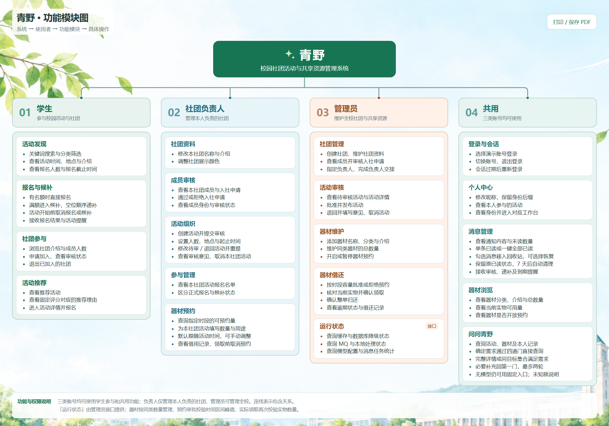
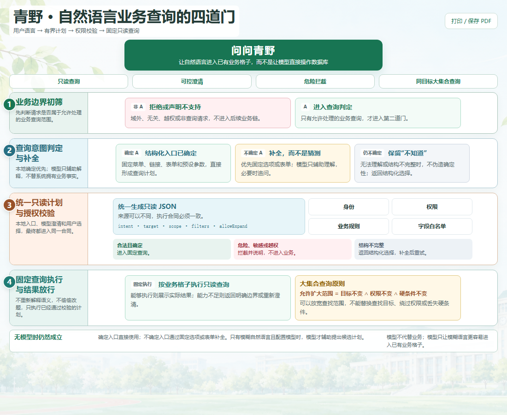

# 青野：让校园里的好事发生

青野把找社团、参加活动、借用器材和接收通知放在一个微信小程序里。同学用它参与校园生活，社团负责人组织活动，管理员处理审核和共享资源。

项目使用 Java 17、Spring Boot、MySQL 8 和原生微信小程序。业务由一个后端提供，模型是可选的查询入口。

## 从发现到参与

首页可以搜索活动、查看推荐，也可以进入社团、我的活动、公告和问问青野。搜索记录按账号在本机保留最近五条，支持逐条删除。

| 使用者 | 可以做什么 |
| --- | --- |
| 同学 | 看社团介绍、申请入社；报名活动、候补和取消；查看器材及自己的借用记录；阅读、归档和恢复公告 |
| 社团负责人 | 编写社团介绍、审批成员、管理活动与报名名单，为活动申请器材 |
| 管理员 | 审核活动、维护器材数量、审批借用、登记领取和归还、管理账号权限、发布和维护公告 |

学生的底部导航提供器材室；管理员和社团负责人从工作台进入。公告中的使用指引随项目维护，管理员发布校园通知和更新消息。个人归档只改变自己的列表。

[查看完整功能模块图](功能模块图.html) · [运行与配置](../README.md)

## 问问青野：能查就查，需要补充时再问

“明天有哪些活动？”“相机还有多少？”“我报了哪些活动？”——用户用一句话开始，结果按记录展示为卡片。需要自己选择条件时，进入独立的“自己查找”页面，选择活动、器材、报名或借用，各类筛选分别保存。

助手后端使用四道门，让模型理解与业务执行各负其责：

| 门 | 职责 |
| --- | --- |
| 第一门：业务初筛 | 拦住明确越界的请求，保留需要解释的业务语言 |
| 第二门：结合业务能力判断 | 固定入口直接形成请求；模型辅助判断自然语言是否确定，必要时补充 |
| 第三门：只读合同与授权 | 校验有限字段、取值和机器可核验的来源；身份取自登录会话 |
| 第四门：固定查询与结果 | 按对应业务能力查询数据库，返回真实记录或明确的停止结果 |

查询地点可以返回包含地点的完整活动卡；查询某种器材可以返回包含目标的相关集合。扩大集合保持查询目标、已记录条件和权限。新增社团、活动或器材只增加数据，不增加格子或关键词规则。

需要补充或纠正时，保留原问题，从第一门重新走一轮；两轮仍无法确定，就说明不知道。能直接查询的请求一次完成。模型关闭时，目录、表单和固定查询照常可用。

[查看架构图](助手四道门.html) · [当前查询合同](assistant-contract.md)

## 业务正确性由数据库落实

- **报名与候补**：锁定活动后处理名额；取消报名后按顺序递补。
- **器材容量**：按预约时间区间扫描数量峰值，审批时用器材行锁重新核算；领取时另查实际未归还数量。
- **权限**：负责人权限属于具体社团；每次请求读取当前身份，管理写入等待锁后再核验权限。新微信账号默认是普通用户，管理员由已有管理员授予。
- **公告并发**：修改、删除携带版本，旧版本操作返回冲突，编辑页保留草稿；预置公告不能由管理员改删。
- **消息与任务**：业务变化和通知任务一起入库。消息可移入回收站，七天内恢复；公告归档长期保留。

后端按接口、业务事务、数据库访问和外部集成组织代码。当前 schema 包含 14 张表，定义见 [schema.sql](../backend/src/main/resources/schema.sql)。

## 已有实测

391 个任务覆盖正常业务、长尾表达、攻击输入、历史语义反例和结果纠正。任务按最终业务结果评分：合法集合覆盖和纠正后查对都算查对；停止与故障分别记录。

| 实验 | 查对 | 停止、未找到或信息不足 | 查错 | 技术故障 |
| --- | ---: | ---: | ---: | ---: |
| DeepSeek、千问、GPT：共 1173 条冻结回包，经接口修复复算 | 666 | 493 | 1 | 13 |
| 豆包 2.1 Pro：391 个任务独立实测 | 222 | 168 | 0 | 1 |

第一行是同一批模型回包的程序对照；第二行是另一轮真实调用，两者分别保留原始记录。模型仍可能漏掉用户条件，合法协议也不能自动证明理解正确。详见[接口修复对照](assistant-contract-handoff-20261030.md)和[豆包完整题库](assistant-doubao-full-20261030.md)。

本轮公告、认证、并发、客户端与 HTTP 压测的结果集中在[发布前检查](release-check-20261104.md)。本地发布候选采用单实例 MySQL，Redis 和 RabbitMQ 默认关闭；部署步骤见[部署说明](deployment.md)。
